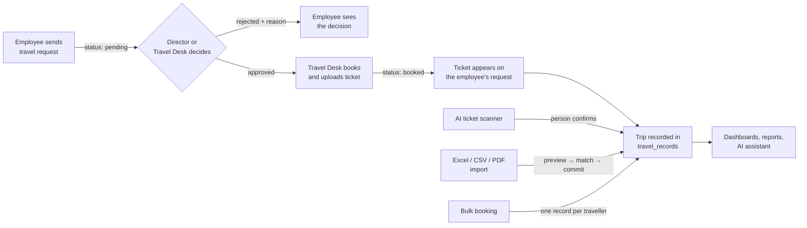
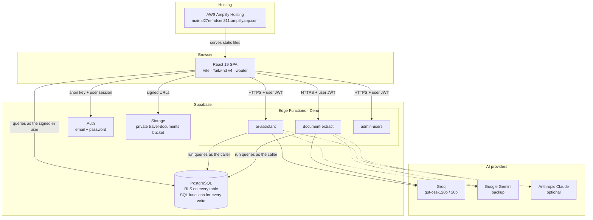

# Trapple (Travora)

**Trapple** (also branded **Travora**) is a corporate travel management platform. Employees ask for trips. The Director or the Travel Desk approves them. The Travel Desk books the travel and attaches tickets. Management then sees where the money went, broken down by project, employee, route and month.

It replaces spreadsheets and email threads with one web app. Every permission is enforced in the database, and AI helps with reading tickets and answering questions about travel data.

- **Live site:** https://main.d27refhdsen811.amplifyapp.com (AWS Amplify Hosting, built from `main`).
- **Backend:** Supabase (PostgreSQL, Auth, Storage, Edge Functions).

---

## Contents

- [What the app does](#what-the-app-does)
- [Roles](#roles)
- [The travel workflow](#the-travel-workflow)
- [Architecture](#architecture)
- [Repository layout](#repository-layout)
- [Running it locally](#running-it-locally)
- [Deployment](#deployment)
- [Checks and tests](#checks-and-tests)
- [Security model](#security-model)
- [Legacy Spring Boot path](#legacy-spring-boot-path)
- [Further documentation](#further-documentation)

---

## What the app does

| Area | What it covers |
| --- | --- |
| **Travel requests** | Employees describe a trip: one-way or round trip, route, dates, project, preferred times, hotel needs and notes. The Director and the Travel Desk see it at the same time, and whoever decides first wins. The decision and its reason are shown to the employee. |
| **Tickets** | After approval, the Travel Desk uploads the ticket against the request, and it appears next to that request in the employee's portal. |
| **AI ticket scanner** | Upload a PDF or a photo of a ticket. The app pulls out PNR, dates, route, fare and passenger. Every value is checked again in code, and nothing becomes a trip until a person confirms it. |
| **Bulk / group bookings** | One booking for up to 500 travellers. Each person gets their own trip record, and the cost is split evenly or set per person. |
| **Spreadsheet & PDF imports** | The Travel Desk uploads real company travel workbooks (Excel, CSV or PDF). The upload goes through preview, checks, name matching and project mapping before anything is saved. Each upload gets its own report. |
| **Expenses** | Employees and staff record expenses, and the Director or Travel Desk approves or rejects them. |
| **BI dashboards** | Overview, projects (with drill-down), travel, employees, finance, insights and downloadable reports. A travel map is built from a seeded airport, railway station and city dataset. |
| **AI assistant** | A floating chat that answers questions such as "how much did project X spend in October?". It can only call fixed, permission-checked queries and can produce downloadable reports. |
| **People management** | Create or invite employees, give them logins, reset passwords, mark people as left, and delete or reset data (Director and Travel Desk only). |

---

## Roles

Roles are stored in `profiles.role` in the database and are never taken from the browser.

| Role in the database | Shown in the app as | What they can do |
| --- | --- | --- |
| `employee` | Employee | "My workspace": send travel requests, see decisions, see their own trips, tickets and documents. |
| `approver` | Approver | Their own workspace, plus their team's requests and expenses. |
| `travel_desk` | Booking assistant | The older, limited booking role. |
| `company_admin` | **Travel Desk** | Full portal: requests, tickets, uploads, expenses, people, dashboards and the assistant. |
| `admin` | **Director** | Same permissions as the Travel Desk, with the Director dashboard. |

People can also sign up themselves if the option is switched on. They always start as `employee`, and sign-up can be limited to company email domains (see `docs/SIGNUP.md`).

---

## The travel workflow



Request statuses: `pending` → `approved` / `rejected` → `booked` → `completed`, or `cancelled` at any point.

Trips can come into `travel_records` in four ways: an approved and booked request, a ticket scan confirmed by a person, a spreadsheet or PDF import, or a bulk booking. Each trip remembers its source, so it can be traced back. All of them feed the same reports and dashboards.

---

## Architecture



### Frontend (`client/`)

- **React 19 + TypeScript 5.6**, built with **Vite 7**, styled with **Tailwind CSS v4**, routed with **wouter**.
- Charts use Recharts and the map uses d3-geo, topojson and world-atlas. Files are read with read-excel-file, xlsx, papaparse and pdfjs-dist, and exported with jspdf.
- The Supabase screens are in `client/src/pages/travel/`. Each one is lazy-loaded as its own chunk, and the route/role table is in `pages/travel/routes.tsx`.
- Data access is in `client/src/lib/data/*`, with one module per area (travel, bulk, documents, imports, BI, spend, assistant and so on).
- The browser only ever holds the **public anon key** and the user's own session, which is stored in `sessionStorage`. The app refuses to start if it is given a service-role key.

### Database (`supabase/migrations/`)

There are 28 ordered SQL migrations. The main tables are:

| Table | Purpose |
| --- | --- |
| `profiles` | Employees and their roles; one row per person, linked to a Supabase Auth login when they have one. |
| `travel_requests` | Requests and their decisions. |
| `travel_records` | Every trip, whatever its source. |
| `documents` | Uploaded tickets and files; can be linked to a trip or a request. |
| `approvals`, `audit_logs` | Decision history and an audit trail (ids only, no booking details). |
| `bulk_bookings`, `bulk_booking_members` | Group bookings. |
| `expenses` | Expense claims and decisions. |
| `import_batches`, `import_rows`, `name_match_reviews` | The staged spreadsheet/PDF import pipeline. |
| `companies`, `projects`, `project_aliases`, `cost_lines` | Project and cost data for BI. |
| `locations`, `location_aliases` | Airports, railway stations and cities with coordinates (seeded by `scripts/locations/make_seed.py`). |
| `ai_conversations`, `ai_messages` | Assistant chat history. |

Changes that matter go through **SQL functions**, for example `decide_travel_request`, `document_confirm`, `bulk_save`, `import_stage_v2` / `import_commit_v2`, `decide_expense` and the `bi_*` / `ceo_dashboard` report functions. These functions check permissions and validate input again, so a plain API call cannot skip a rule.

### Edge Functions (`supabase/functions/`)

| Function | What it does |
| --- | --- |
| `ai-assistant` | Chat assistant. The model can only ask for one of a fixed set of tools (`_shared/assistantTools.ts`), such as `get_my_travel_history`, `find_spend`, `list_travel_requests` or `company_overview`. Each tool runs as the signed-in user, so database permissions still apply. Uses Groq first, with a smaller backup model when Groq is busy; Gemini or Anthropic can be used instead. |
| `document-extract` | Ticket scanner. It reads the PDF text layer first and only sends the file itself to a model when there is no usable text. The model fills a fixed JSON schema, and `_shared/ticket.ts` re-checks every field. It is limited to 30 scans per person per hour, with the limit kept in the database. |
| `admin-users` | Invites users. This is the only place the service-role key is used. |

---

## Repository layout

```
client/                 React app (src/pages, src/components, src/lib/data, src/__tests__)
supabase/
  migrations/           Database schema, RLS, SQL functions, seed data
  functions/            Deno Edge Functions + _shared helpers
  tests/                RLS / permission test suite (run_local.sh)
  README.md             Supabase setup and feature notes, phase by phase
.github/workflows/
  checks.yml            Runs on every PR and push to main
  deploy-functions.yml  Deploys Edge Functions to the live Supabase project
docs/                   Deploy, security, sign-up and branch protection guides
deploy/aws/             Amplify rewrite rules
scripts/locations/      Generates the airports/stations/cities seed migrations
server/index.ts         Small Express static server (not used in production)
backend/                Legacy Spring Boot API (see below)
vercel.json, amplify.yml, customHttp.yml   Hosting config + security headers
```

---

## Running it locally

**Requirements:** Node 20.19+ (22 recommended) and pnpm 10. The Supabase CLI is only needed for database work.

```bash
pnpm install
cp .env.example .env.local
```

Edit `.env.local`:

```bash
VITE_AUTH_PROVIDER=supabase
VITE_SUPABASE_URL=https://<project-ref>.supabase.co
VITE_SUPABASE_ANON_KEY=<anon public key>   # never the service_role key
VITE_ENABLE_SIGNUP=false
```

Then:

```bash
pnpm dev        # http://localhost:3000
```

Other scripts:

| Command | What it does |
| --- | --- |
| `pnpm check` | TypeScript type check. |
| `pnpm test` | App unit tests (`client/src/__tests__/*.test.ts`, run with tsx). |
| `pnpm test:rls` | Starts a throwaway PostgreSQL, applies every migration and runs the permission tests. Needs PostgreSQL 15+ binaries and a non-root user. |
| `pnpm build` | Production build into `dist/public`. |
| `pnpm format` | Prettier. |

### Database and functions

```bash
supabase login
supabase link --project-ref <ref>
supabase db push                      # applies supabase/migrations
supabase functions deploy admin-users ai-assistant document-extract
```

For the very first Director account, run `supabase/bootstrap_first_admin.sql` in the SQL editor. Full details are in [`supabase/README.md`](supabase/README.md).

---

## Deployment

| Part | Where | How it gets there |
| --- | --- | --- |
| **Website** | **AWS Amplify Hosting**: https://main.d27refhdsen811.amplifyapp.com | Amplify builds `main` automatically on every push. `amplify.yml` is the build (Node 22, pnpm, `vite build` → `dist/public`), `customHttp.yml` sets strict security headers (CSP, HSTS, frame-deny), and `deploy/aws/amplify-rewrites.json` holds the SPA routing rules pasted into the Amplify console. Setup guide: [`docs/DEPLOY_AWS.md`](docs/DEPLOY_AWS.md). |
| Website (old) | Vercel: travora-ashy.vercel.app | The earlier host. `vercel.json` is still in the repo and the Vercel address is still allowed in CORS and auth redirects, but it is not the live site. |
| **Database** | **Supabase** (hosted PostgreSQL) | `supabase db push` from `supabase/migrations/`. |
| **Edge Functions** | **Supabase** | Deployed automatically by `.github/workflows/deploy-functions.yml` whenever `supabase/functions/**` or `supabase/config.toml` changes on `main`, or by hand from the GitHub Actions tab. Guide: [`docs/DEPLOY_FUNCTIONS.md`](docs/DEPLOY_FUNCTIONS.md). |

**Hosting environment variables** (set in the Amplify console under App settings → Environment variables; baked in at build time, so click **Redeploy this version** after changing them):

- `VITE_AUTH_PROVIDER=supabase`
- `VITE_SUPABASE_URL`
- `VITE_SUPABASE_ANON_KEY`
- `VITE_ENABLE_SIGNUP` (optional)

**GitHub repository secrets** used by the functions deploy workflow:

- `SUPABASE_ACCESS_TOKEN` (required)
- `GROQ_API_KEY`, `GEMINI_API_KEY` (AI keys, pushed into Supabase secrets)
- `SUPABASE_PROJECT_REF` (optional; defaults to the live project)
- Repository variable `ALLOWED_ORIGINS`: the websites allowed to call the functions (CORS)

AI keys live **only** in Supabase function secrets. They never get a `VITE_` prefix and never go into the browser bundle.

---

## Checks and tests

`.github/workflows/checks.yml` runs on every pull request and every push to `main`:

1. **App:** `pnpm check`, `pnpm test`, `pnpm build`
2. **Database security:** applies every migration to a throwaway PostgreSQL and runs the RLS test files in `supabase/tests/`
3. **Edge Functions:** `deno check` on every function

Branch protection should require all three to pass before a PR is merged into `main`. See [`docs/BRANCH_PROTECTION.md`](docs/BRANCH_PROTECTION.md).

---

## Security model

**The database decides.** Screens hide what a role can't do, but every read and write is checked again by Row Level Security or by a SQL function.

- RLS is on every table. Employees see their own data, approvers see their team's and staff see everyone's. Every view is `security_invoker`, and every `security definer` function pins `search_path`.
- Reports, dashboards, the scanner and the assistant all run **as the signed-in user**, so they cannot see more than that user can.
- Files are kept in a private bucket with one folder per employee. Uploads are limited to 10 MB of PDF or image files (checked by file signature), and downloads use 60-second signed URLs.
- AI models never see SQL, keys or the database directly, and anything a model returns is validated in code before it is used.

Full details are in [`docs/SECURITY.md`](docs/SECURITY.md).

---

## Legacy Spring Boot path

The project began as a Spring Boot API with a single large React file. Both are still in the repo:

- `backend/`: Java 21, Spring Boot, Spring Security with JWT, JPA and PostgreSQL. `docker-compose.yml` runs it locally with Postgres.
- `client/src/App.tsx` and `client/src/lib/api.ts`: the original UI and API client, used when `VITE_AUTH_PROVIDER=legacy`. In that mode it calls `https://trapple.onrender.com`, which is also the target of the `/api` rewrite in the Amplify rules and `vercel.json`.

The live site runs in **Supabase mode** and does not need the Spring Boot server. The audit reports at the repo root (`TRAVORA_PRODUCTION_AUDIT.md`, `TRAVORA_BACKEND_HOSTING_REVIEW.md`, `SECURITY_AUDIT_PHASE14.md`) describe this legacy prototype from before the move to Supabase. To retire it, follow "Retiring the legacy Spring Boot backend" in `docs/SECURITY.md`.

---

## Further documentation

| File | Topic |
| --- | --- |
| [`supabase/README.md`](supabase/README.md) | Supabase setup and notes on each feature phase (scanner, bulk bookings, reports…) |
| [`docs/SECURITY.md`](docs/SECURITY.md) | Trust boundaries, controls, go-live checklist |
| [`docs/DEPLOY_FUNCTIONS.md`](docs/DEPLOY_FUNCTIONS.md) | Connecting the AI keys and deploying functions from GitHub |
| [`docs/DEPLOY_AWS.md`](docs/DEPLOY_AWS.md) | Hosting the site on AWS Amplify |
| [`docs/SIGNUP.md`](docs/SIGNUP.md) | Self sign-up and allowed email domains |
| [`docs/BRANCH_PROTECTION.md`](docs/BRANCH_PROTECTION.md) | Protecting `main` |
| [`scripts/locations/README.md`](scripts/locations/README.md) | Where the map coordinates come from |

## License

MIT (see `package.json`).
